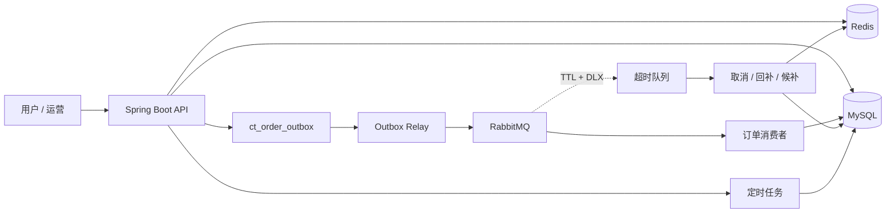
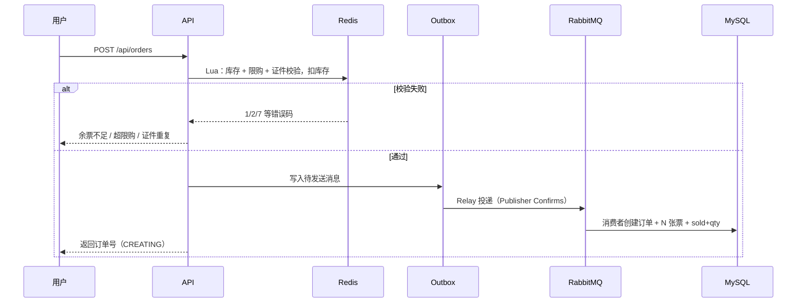
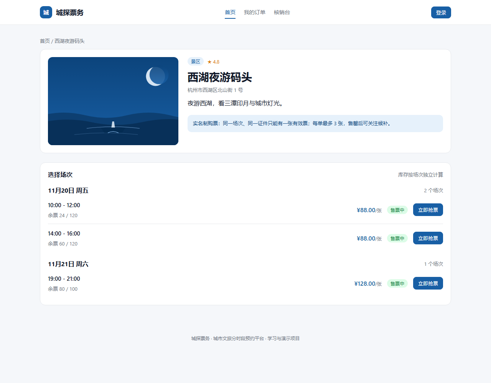
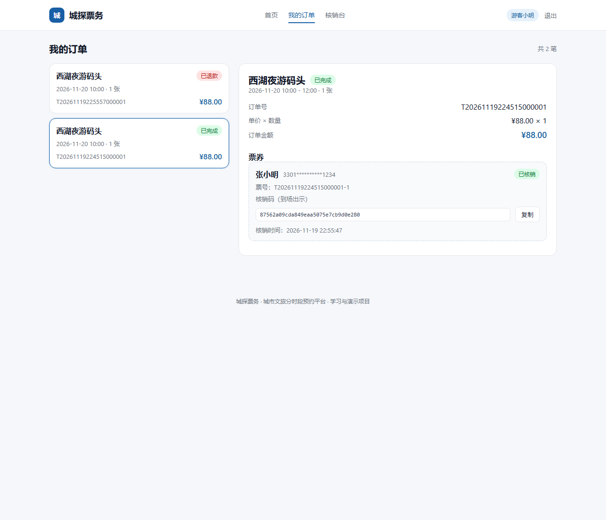
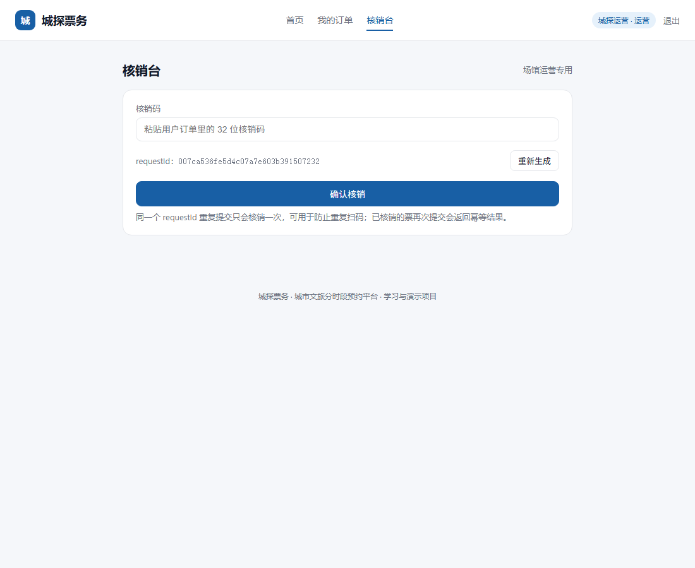
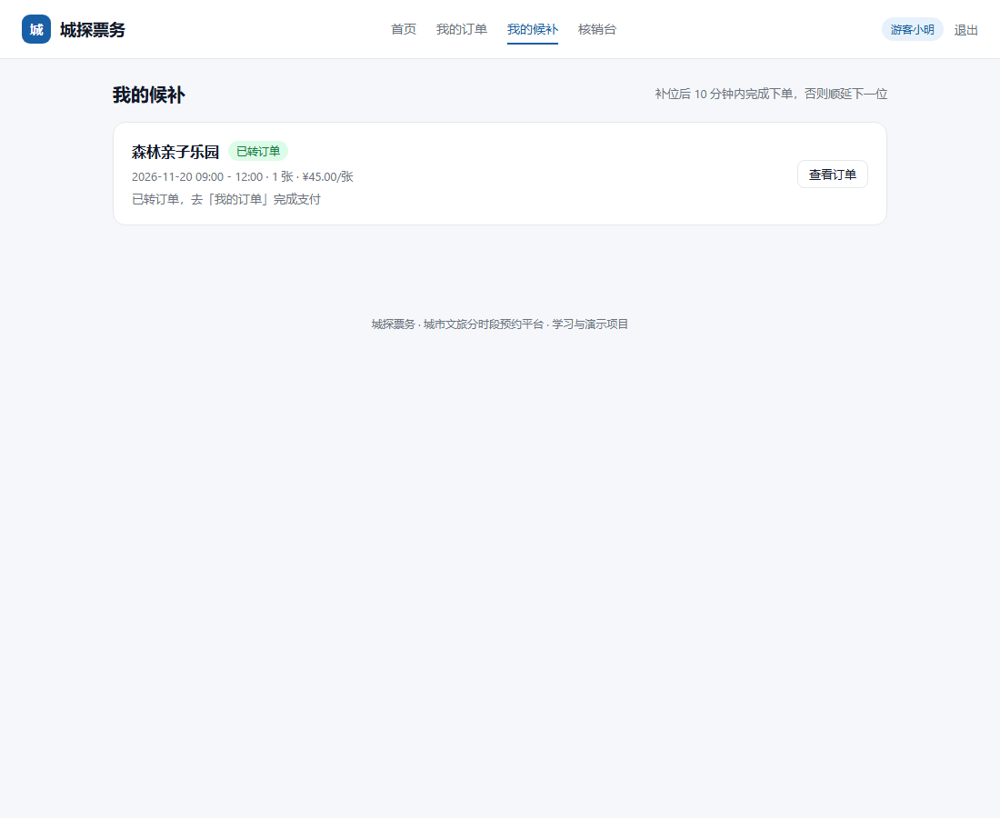
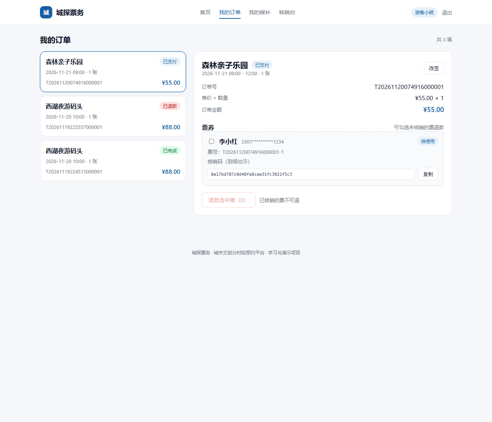

# 城探票务（chengtan-ticket）

[](https://github.com/Bulibuli-888/chengtan/actions/workflows/ci.yml)

面向城市文旅场馆的**分时段预约票务系统**，覆盖「选场次 → 实名抢票 → 支付 → 核销 / 退款 → 售罄候补 → 跨场次改签」全链路。

项目的核心不是 CRUD，而是**场次级库存、订单 / 票双状态机、库存与消息的最终一致性**。


## 1. 功能

### 用户端

- 手机验证码登录，token 存 Redis，滑动续期
- 场馆分类、场馆详情、附近场馆（Redis GEO）
- 场次列表：按日期分组，展示余票、价格、售票状态
- 抢票：每单 1~3 张，每人每场次限购 3 张，实名一证一票
- 订单：待支付倒计时、模拟支付、取消、按票退款
- 改签：已支付订单可改到同场馆其他场次，自动计算差价
- 候补：售罄后排队，有人退票 / 取消时自动补位，10 分钟内可转订单
- 票夹：一票一码，到场出示核销码

### 运营端

- 核销台：仅 `role=1` 的运营账号可用
- `requestId` 幂等：重复扫码不会重复核销，已核销的票返回幂等结果

### 系统能力

- 缓存穿透（空值缓存）、击穿（互斥锁）、雪崩（TTL 随机偏移）
- Redis Lua 原子扣减 + MySQL 乐观条件更新，双层防超卖
- RabbitMQ 异步下单，Publisher Confirms + 手动 ACK + DLQ
- 本地消息表（Outbox）解决「Redis 扣减成功但 MQ 投递失败」；重试窗口约 15 分钟，耗尽后可 `POST /api/admin/outbox/replay` 人工重放
- 下单请求级幂等：同一 `requestId` 重复提交返回同一订单号，不会二次扣库存
- TTL + 死信队列实现支付超时，另有扫表兜底
- 库存对账任务：Redis 库存高于数据库时单向修正，优先保证不超卖
- 统一返回结构、业务错误码、全局异常、Swagger、Actuator
- Micrometer 业务指标：抢票结果、订单创建、核销结果，`/actuator/prometheus` 直接可抓

## 2. 技术栈

| 分类 | 技术 |
|---|---|
| 语言 / 运行时 | Java 17（本机 JDK 24 运行） |
| 框架 | Spring Boot 3.5.14 |
| ORM | MyBatis-Plus 3.5.9 |
| 数据库 | MySQL 8.0 |
| 缓存 | Redis + Lettuce |
| 消息队列 | RabbitMQ 3.13.7（Erlang 26） |
| 接口文档 | springdoc-openapi 2.8.9 |
| 可观测 | Micrometer + Prometheus 指标 + Actuator 健康检查 |
| 工具 | Hutool、Lombok |
| 前端 | Vue 2.5 + Axios + 原生 CSS（无构建步骤） |

## 3. 架构



## 4. 核心链路与设计取舍

### 4.1 抢票：Lua 原子扣减 + Outbox + MQ



- **为什么用 Lua**：库存判断、每人限购计数、证件集合校验、扣减必须原子完成，否则高并发下一定超卖或重复。
- **为什么还要 Outbox**：Redis 扣减和 MQ 投递不是同一个事务。先落本地消息表，Relay 失败重试；消费端用 `order_no` 唯一约束兜底幂等。
- **为什么 Redis 和 DB 双层校验**：Redis 挡掉绝大多数无效流量，DB 的 `sold + qty <= capacity` 条件更新是最后一道防线。

### 4.2 支付超时：延迟队列 + 扫表兜底

- 下单成功后投递到 `ticket.order.delay.queue`，队列级 TTL 15 分钟，到期死信到 `ticket.order.timeout.queue`。
- 消费者做条件更新 `status: 10 → 40`，票 `10 → 40`，`sold - qty`，回补 Redis 库存与限购计数。
- 另有 `OrderTimeoutFallbackJob` 每分钟扫一次 `status=10 AND expire_time < now`，防止 MQ 消息丢失。

### 4.3 候补：ZSet 排队 + 预扣库存

- 加入候补：写 `ct_waitlist`，同时 `ZADD waitlist:queue:{sessionId}`，score 为排队时间。
- 库存释放（取消 / 退款 / 超时）后，`onStockReleased` 取队首，**先在 Redis 预扣库存**，再把候补状态改为 `1 已通知待支付`，有效期 10 分钟。
- 预扣库存是为了避免「通知了用户，但票被别人抢走」；过期未支付则回补库存并顺延下一位。
- 转订单时不再扣库存，只校验限购和证件，走同一套 Outbox + MQ 创建订单。
- **为什么用 Redis ZSet + MySQL**：ZSet 负责排队、取队首、查位置；MySQL 负责持久化、状态机和唯一约束。

### 4.4 改签：库存预扣 + 数据库行锁

- 前置校验：已支付、所有票未核销、目标场次同场馆且可售、目标余票足够。
- Redis 预扣目标场次库存；DB 事务内按 `sessionId` 从小到大 `SELECT ... FOR UPDATE` 锁两个场次，避免死锁。
- 同一事务内：目标 `sold + qty`、原场次 `sold - qty`、票的 `session_id`、订单金额和 `ct_reschedule` 记录。
- 成功后回补原场次 Redis 库存；失败则回补目标场次预扣库存。
- 差价直接体现在订单金额与 `ct_reschedule.price_diff`，支付/退款为模拟。

### 4.5 核销与退款

- 核销：二维码 `qr_token` 一次性使用，`ct_verify_log.request_id` 唯一 + `ticket_id` 唯一，状态条件更新。
- 重复 requestId 返回 `idempotent=true`，不会重复核销。
- 退款按票进行：只允许 `status=10` 的票，退完重算订单状态；已核销的票不可退。
- 退款 / 取消后都会触发候补补位。

### 4.6 库存对账

`StockReconcileJob` 每 5 分钟对活跃场次做一次检查：

- `Redis 库存 > DB 可售`：说明 Redis 多了，直接改成 DB 值，防止超卖。
- `Redis 库存 < DB 可售`：可能是候补预扣或消息在途，只记录告警，不自动加回。

## 5. 数据模型（11 张表）

| 表 | 说明 |
|---|---|
| `ct_user` | 用户，`role=1` 为场馆运营 |
| `ct_venue_type` | 场馆分类 |
| `ct_venue` | 场馆，含经纬度（Redis GEO） |
| `ct_venue_session` | 场次，库存按场次隔离 |
| `ct_attendee` | 出行人，证件只存哈希 + 掩码 |
| `ct_ticket_order` | 订单 |
| `ct_ticket` | 票实例，一张票一行 |
| `ct_waitlist` | 候补队列 |
| `ct_reschedule` | 改签记录 |
| `ct_order_outbox` | 本地消息表 |
| `ct_verify_log` | 核销日志，requestId 幂等 |

**一证一票的关键设计**：`ct_ticket` 有一个生成列 `active_flag`（有效票为 1，退款/作废为 NULL），唯一索引 `(session_id, attendee_id, active_flag)`。这样同一场次同一证件只能有一张有效票，退款后又能重新购买。

## 6. 状态机

```text
订单：10 待支付 → 20 已支付 → 30 已完成
        ├→ 40 已取消
        ├→ 60 已过期
        └→ 50 已退款（全部票退完）

票：  10 待使用 → 20 已核销
        ├→ 30 已退款
        └→ 40 已作废

候补：0 排队中 → 1 已通知待支付 → 2 已转订单
        ├→ 3 已取消
        └→ 4 已过期
```

所有状态流转都用 `UPDATE ... WHERE status = 期望值` 做条件迁移，避免并发下的非法流转。

## 7. 正确性验证（2026-11-20 手动回归）

| 场景 | 结果 |
|---|---|
| 场次容量 60，两笔订单占满 | `sold=60`，场次 `status=2`，Redis 库存 `0` |
| 候补排队 | 队列位置 `1` |
| 取消一笔订单触发补位 | `sold 60→59`，候补状态 `0→1`，库存预扣为 `0`，有效期 10 分钟 |
| 候补转订单 | 订单创建成功，`sold=60`，候补状态 `2 已转订单` |
| 改签 场次10 → 11 | `sold 60/22 → 59/23`，Redis 库存 `0/38 → 1/37`，差价 `0` |
| 改签 场次11 → 12（价格 45→55） | 订单金额 `45→55`，差价 `+10`，票 `session_id` 更新 |
| 同场次改签 | `B6002 目标场次与原场次相同` |
| 跨场馆改签 | `B6001 只能改签到同一场馆的场次` |
| 核销 | 票 `10→20`，订单 `20→30`，同 requestId 重放 `idempotent=true` |
| 退款 | 票 `30`，订单 `50`，退款金额 88，Redis 库存回补 |

> 旧版 JMeter 报告已删除（口径与当前实现不一致）。本轮只做正确性回归，**没有虚构 QPS 数字**；压测脚本与数据见 [`docs/loadtest.md`](docs/loadtest.md)。

### 7.1 自动化测试：核心不变量

`mvn test` 共 17 个用例，其中 `TicketingInvariantTest` 跑的是**真实 MySQL + Redis**，不是 mock：

| 用例 | 断言的不变量 | 验证方式 |
|---|---|---|
| 100 并发抢 20 张 | 不超卖、不少卖 | 成功下单数 = 20，订单数 = 票数 = 20，DB `sold` = 20，Redis 库存 = 0 |
| 同一条消息并发投递 8 次 | 只生成 1 个订单 | 8 个线程同时 `handleCreateMessage`，`SUCCESS` 恰好 1 次，库存只扣 1 |
| 未支付超时取消 | 库存与限购计数双回补 | 订单 `40`、票 `40`、DB `sold=0`、Redis 库存回到 3、证件占用释放 |
| 已支付按票退款 | 状态收敛且可再购 | 订单 `50`、票 `30`、库存回补、证件集合移除 |
| 同一 requestId 重复核销 | 幂等一次 | 第一次 `idempotent=false`，第二次 `true`，`ct_verify_log` 只有 1 条 |
| 同证件重复购票 | 一证一票 | 第二次被 Lua 拦截并提示证件重复，库存不被二次扣减 |
| 同一 requestId 重复下单 | 不重复扣库存 | 两次返回同一订单号，`ct_order_outbox` 只有 1 条 |

测试通过 `@MockitoBean` 替换 MQ 生产者，避免测试消息被正在运行的实例消费；`application-test.yaml` 关闭全部定时任务与消费者容器，保证断言确定性。

> 并发用例第一次跑是失败的：线程池只有 32 个线程却要求 100 个任务同时就绪，直接卡死。这类问题只有真的跑并发才会暴露，也是这个项目里最值得讲的一段。

### 7.2 压测：本机实测，不是估算

`scripts/loadtest.py`（零第三方依赖）自建夹具、并发施压、等异步落库后校验一致性，跑完自动清理。

| 并发 | 库存 | 成功 | 拒绝（B1001） | QPS | P50 | P99 | 超卖 |
|---|---|---|---|---|---|---|---|
| 100 | 100 | 100 | 0 | 366 | 81ms | 182ms | 否 |
| 200 | 200 | 200 | 0 | 547 | 79ms | 180ms | 否 |
| 300 | 200 | 200 | 100 | 818 | 66ms | 161ms | 否 |
| 500 | 400 | 400 | 100 | 966 | 67ms | 168ms | 否 |
| 1000 | 800 | 800 | 200 | 244~337 | 803ms | 943ms | 否 |
| 300（冷启动首跑） | 200 | 200 | 100 | **178** | **1151ms** | 1642ms | 否 |

三个值得在面试里讲的结论：

1. **冷启动首跑只有预热后的 1/4.6**（178 vs 818 QPS）。不标注冷启动的漂亮数字没有意义。
2. **瓶颈在压测客户端**（Python GIL + 每请求短连接 + 与同机抢 CPU），不在服务端：并发从 50 涨到 500，P50 稳定在 67~113ms；加到 1000 线程 QPS 反而掉到 244，是施压端先饱和。
3. 1000 并发 / 800 张票，**零超卖**，最终订单数与库存严格一致。

完整方法、口径与局限见 [`docs/loadtest.md`](docs/loadtest.md)。

### 7.3 可观测性

`/actuator/prometheus` 暴露三类业务指标（只做结果计数，不把 userId / sessionId 放进 tag，避免高基数）：

| 指标 | 类型 | 说明 |
|---|---|---|
| `chengtan_seckill_total{result}` | counter | 抢票结果：`success` / `sold_out` / `limit` / `not_on_sale` / `ended` / `not_init` / `id_dup` / `duplicate` |
| `chengtan_order_success_total` | counter | 消费端成功创建的订单数 |
| `chengtan_ticket_verify_total{result}` | counter | 核销结果：`ok` / `idempotent` |
| `chengtan_outbox_dead_total` | counter | 本地消息表重试耗尽条数，**应配告警** |

压测 20 张票 / 30 并发后的真实采样：

```
chengtan_seckill_total{result="success"} 20.0
chengtan_seckill_total{result="sold_out"} 10.0
chengtan_order_success_total 20.0
```

> 踩坑记录：指标最初叫 `chengtan_order_created_total`，被 Micrometer 规范化成 `chengtan_order_total` —— 因为 `_created` 是 Prometheus 的保留后缀，会被裁掉。

### 7.4 故障演练（真的把组件打死过）

完整记录见 [`docs/failure-drill.md`](docs/failure-drill.md)，每条都有注入命令、观测数据和恢复结果。

| 场景 | 注入方式 | 结果 | 是否暴露问题 |
|---|---|---|---|
| 消费端停机 | 关闭 listener 容器 | 30 条积压，恢复后 30 单全部落库，不丢不重 | 否 |
| RabbitMQ 宕机 | `rabbitmqctl stop` | 接口仍成功、消息进本地消息表 | **是：重试 5 次后进入终态，恢复后不再补投** |
| 改签写库失败 | MySQL 触发器 | 订单/票/两场次库存/Redis 全部回滚，对照组正常 | 否 |

演练挖出的缺陷已经修掉：重试上限 5 → 20（覆盖约 15 分钟），耗尽打 ERROR + 指标 `chengtan_outbox_dead_total`，并提供 `POST /api/admin/outbox/replay` 重放。修复后实测：MQ 恢复 32 秒自动补投完成；超窗口的死信调重放接口 2 秒内补投 10 单。

## 8. 本地启动

### 环境要求

- JDK 17+
- Maven 3.9+
- MySQL 8.0
- Redis 6+
- RabbitMQ 3.13（Erlang 26）

### 方式一：本机中间件

```bash
# 1. 初始化数据库（会创建 chengtan_v2）
mysql -uroot -p < src/main/resources/db/chengtan_ticket.sql

# 2. 启动 RabbitMQ（Windows 脚本）
scripts\start-rabbitmq.bat

# 3. 设置环境变量（不要把密码写进配置文件）
set MYSQL_PASSWORD=你的MySQL密码
set REDIS_PASSWORD=你的Redis密码

# 4. 启动
mvn spring-boot:run
```

打开 `http://localhost:8081`。

- 验证码打印在服务端控制台，开发环境没有接短信通道。
- 运营账号：`13800000000`（可进核销台）。
- 普通账号：任意合法手机号，自动注册。

### 方式二：Docker Compose

```bash
docker compose up -d
```

| 服务 | 端口 | 账号 |
|---|---|---|
| MySQL | 3307 | root / chengtan |
| Redis | 6380 | 密码 chengtan |
| RabbitMQ | 5672 / 15672 | guest / guest |

启动应用时覆盖端口：

```bash
set MYSQL_PORT=3307
set MYSQL_PASSWORD=chengtan
set REDIS_PORT=6380
set REDIS_PASSWORD=chengtan
mvn spring-boot:run
```

### 接口文档

- Swagger UI：`http://localhost:8081/swagger-ui.html`
- OpenAPI JSON：`http://localhost:8081/v3/api-docs`
- 健康检查：`http://localhost:8081/actuator/health`

### 常用开关

| 配置 | 默认 | 作用 |
|---|---|---|
| `app.jobs.enabled` | `true` | 定时任务总开关（Outbox Relay / 超时兜底 / 候补过期），测试与单机调试时可关闭 |
| `app.reconcile.enabled` | `true` | 库存对账任务开关 |
| `app.seckill.per-user-limit` | `3` | 每场次每人限购张数 |
| `app.seckill.order-timeout-seconds` | `900` | 未支付订单超时时间（秒） |

## 9. 目录结构

```text
src/main/java/com/chengtan
├── auth/          登录、token、拦截器、角色
├── venue/         场馆、分类、GEO 预热
├── session/       场次、库存预热
├── attendee/      出行人（证件哈希 + 掩码）
├── order/         订单、状态机、超时兜底
├── ticket/        票实例
├── waitlist/      候补排队、补位、过期
├── reschedule/    改签记录
├── verify/        核销
├── mq/            拓扑、生产者、消费者、Outbox Relay
├── job/           定时任务
├── common/        返回结构、错误码、缓存、锁、枚举
└── config/        Web、MyBatis、RabbitMQ、Jackson、Swagger
```

按业务分包，而不是 `controller/service/mapper` 三层平铺。

## 10. 已知限制 / Roadmap

- 支付为模拟，未对接真实渠道、异步回调和账单
- 短信验证码打印日志，未接短信服务
- 候补通知只做站内状态，未接短信 / 推送
- 单库单表，未分库分表；当前定位是演示与面试项目
- 压测为单机短连接、客户端与服务端同机，**不代表集群能力**
- **Redis 宕机未做降级**：缓存层挂掉会直接影响抢票与查询，目前没有"只读走 DB"的兜底
- 多实例只在设计上支持（Outbox 锁、消费幂等），未真的起两个进程验证
- 前端是 Vue 2 + 原生 CSS，未做工程化构建

## 11. 面试可以展开的 7 个问题

1. Redis 已经扣了库存，为什么还要写 Outbox？
2. 消息重复投递时，如何保证不重复创建订单？
3. 用户连点两次「抢票」，怎么保证只下一单？
4. 候补补位为什么要先预扣库存，不预扣会怎样？
5. 改签要同时动两个场次，怎么保证原子性和避免死锁？
6. 一证一票为什么用生成列 + 唯一索引，而不是只在代码里判断？
7. 核销接口怎么做到幂等？二维码被截图转发怎么办？

## 12. 页面截图

| 首页 | 场馆详情 |
|---|---|
|  |  |

| 订单 / 票夹 | 核销台 |
|---|---|
|  |  |

| 我的候补 | 改签入口 |
|---|---|
|  |  |

## License

MIT
